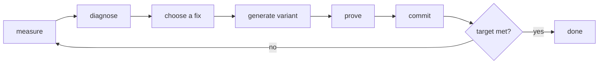

# KernelHarness

[](https://github.com/pythongiant/KernelHarness/actions/workflows/ci.yml)
[](LICENSE)


KernelHarness makes a CUDA kernel faster on a real NVIDIA GPU, and proves with a
machine-checked Lean 4 proof that every faster version still computes the right answer.

It runs a loop. Each round measures the kernel, diagnoses what is slowing it down,
applies one known fix, proves the new kernel correct against a formal model of PTX,
measures it again, and commits everything to a git ledger. It stops when the kernel
meets your target.



**Why:** hand tuning tends to claim speedups without checking correctness, picks fixes
by intuition, and loses the record of what was tried. Here every round carries a
measurement, a diagnosis that quotes the number behind it, and a proof status, and the
ledger keeps all of it, including the dead ends.

> Status: alpha. The loop, the simulator, the Modal GPU backend and the Lean model work
> end to end. Proofs cover exact integer kernels only (see [limits](#what-the-proof-guarantees)).

## Quick start

Needs Python 3.13 and [`uv`](https://docs.astral.sh/uv/). No GPU or Lean is needed to try it.

```bash
uv sync --extra dev
uv run harness init                     # state in .harness/, ledger repo in ledgers/
uv run harness run --kernel elementwise_affine --backend sim --max-rounds 3
uv run harness report                   # rounds of the latest run as JSON
uv run harness serve                    # web UI on http://127.0.0.1:8787
```

The `sim` backend replaces the GPU with a deterministic cost model. It exercises the
whole loop but can never meet the target: simulated numbers are refused by design.

## Example: `elementwise_affine` on an H100

`out[i] = 10 * x[i] + 3` over 4M `s32` elements is 32 MB of traffic, so the roofline
floor at 3350 GB/s is about 10 µs. SOL is the share of that floor actually reached.

```bash
uv run harness run --kernel elementwise_affine --gpu H100 --max-rounds 4 --sol 40
```

| round | fix | SOL | p50 | vs torch | proof |
|---|---|---|---|---|---|
| 0 | baseline | 63.6% | 15.7 µs | 1.10× | VERIFIED |
| 1 | `int4` vectorised load/store | 82.8% | 12.1 µs | 1.49× | VERIFIED |
| 2 | streaming stores + grid-stride loop | 94.3% | 10.6 µs | 1.71× | VERIFIED |

The SOL target was met at round 0, but the default 1.5× speedup target was not, so the
loop continued until every check passed (`SLA_MET`). A repeat run reached 93.7%.
The full output of this run is in [`examples/runs/elementwise_affine-h100/`](examples/runs/elementwise_affine-h100/):
each `round-NN/` holds the profile, diagnosis, chosen fix, kernel source and PTX, diff,
proof status and the generated Lean module.

## How a round works

| stage | what happens |
|---|---|
| **measure** | compile and run on the GPU (Modal), time with `cudaEvent`, compare output bytes with a numpy reference. Produces `p50_ms`, `sol_pct`, occupancy, registers, speedup vs torch, and `numeric: PASS/FAIL`. |
| **diagnose** | fixed rules over those numbers, e.g. occupancy < 50%, memory bound under 70% of peak, no tensor cores in a GEMM. Each finding quotes the metric that triggered it. |
| **choose a fix** | a catalogue maps findings to known techniques with rationale and references, skipping anything already tried. An optional LLM can add candidates but never override measurements. |
| **generate** | the fix selects the next rung of the kernel family's template ladder. A variant identical to its parent is refused. |
| **prove** | the variant is lowered to PTX instructions over a small launch; a generated Lean module asserts every consistent execution writes the reference bytes. `VERIFIED` requires a clean build, no `sorry`, and a passing axiom audit. |
| **commit** | all artifacts go to `ledgers/runs/<run>/round-NN/` and are committed to the ledger repository. |

A variant is kept if it beats its parent's latency or SOL by 3%, or meets the target.
Otherwise it is still committed and the next round starts from the parent. Runs end with
`SLA_MET`, `MAX_ROUNDS`, `STALLED`, `BLOCKED` or `STOPPED_BY_USER`.

## Running on a real GPU

```bash
uv run modal setup                                    # once: Modal account
uv run modal deploy -m harness.backends.modal_gpu     # once: profiling image
uv run harness run --kernel elementwise_affine --gpu H100 --max-rounds 4 --serve
```

Proofs need the Lean toolchain:

```bash
curl -sSfL https://elan.lean-lang.org/elan-init.sh | sh -s -- -y
(cd lean && lake build)                               # prints AUDIT_OK
```

Without Lean, proofs report `UNSUPPORTED` and the target check fails closed.

## Configuration

Run settings are flags (`harness run --help`): `--kernel`, `--gpu`, `--backend`,
`--max-rounds`, `--sol`, `--speedup`. Shapes and tolerances live in the kernel manifest.
Everything else is an environment variable:

| variable | default | purpose |
|---|---|---|
| `HARNESS_STATE_DIR` | `.harness` | SQLite database, device cache, logs |
| `HARNESS_LEDGER_DIR` | `ledgers` | the ledger git repository (separate from this repo) |
| `HARNESS_LLM_BASE_URL` | unset | OpenAI-compatible endpoint for extra fix ideas; unset = catalogue only |
| `HARNESS_LLM_MODEL` | `qwen/qwen3-coder-30b` | model name for that endpoint |
| `HARNESS_GIT_NAME` / `HARNESS_GIT_EMAIL` | git config | ledger commit identity, used only if git has none |

## What the proof guarantees

For the generated `theorem correct : Correct launch post`: every consistent, complete
execution of the kernel's PTX, under a model with 81 instruction forms and eight memory
consistency axioms, ends with memory equal to the reference output. Lean recomputes the
arithmetic itself, so the numpy reference is a cross-check, not an assumption.

Limits, enforced in code:

1. **Integers only.** `s32` kernels can verify. Float kernels and softmax report `UNSUPPORTED`.
2. **No intra-launch communication.** Kernels whose threads read each other's writes
   within one launch are rejected, not accepted unsoundly.
3. **Small instance.** The proof covers a small launch of the same program (e.g. 8
   elements); the full size is covered by the GPU numeric check.

## Project layout

```text
harness/      Python package: the loop, stages, GPU backends, PTX translator, CLI, API
lean/         Lean 4 model of PTX, axiom audit, proof tactic
web/          React UI (run control, round pages, proof viewer)
examples/     a recorded H100 run, a user-supplied kernel, an offline quickstart script
tests/        pytest suite (no GPU or Lean required)
docs/         reference.md: architecture, statuses, the Lean model, operations
```

## Further reading

[`docs/reference.md`](docs/reference.md) covers the internals and troubleshooting.
[`CONTRIBUTING.md`](CONTRIBUTING.md) covers development setup and how to add kernels,
fixes and PTX forms.

## License

[MIT](LICENSE)
