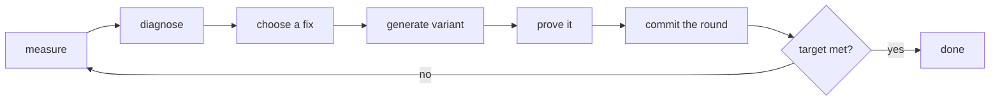

# KernelHarness

KernelHarness is a tool that makes a CUDA kernel faster on a real NVIDIA GPU, and
proves with a machine-checked Lean 4 proof that each faster version still computes
the right answer.

It is a loop, not a single command. For each round it measures the kernel, works out
what is slowing it down, applies one fix, checks the new kernel against a formal model
of PTX, measures it again, and commits everything it learned to a git repository. The
loop stops when the kernel hits the target you set.



## Why this exists

Three things go wrong when people tune kernels by hand:

1. Speedups are claimed without a check that the kernel still computes the right
   result. A fast kernel that is wrong is worse than a slow one.
2. Optimisation decisions are made from intuition instead of measurement, so the same
   wrong fix gets applied twice.
3. The history of what was tried, measured, and rejected is lost after the session.

KernelHarness fixes all three by construction: every round carries a measurement, a
written diagnosis that quotes the number that triggered it, and a proof status. The
git history is the record.

## How a round works

A round has six stages. Each stage writes rows to a local SQLite database and files to
disk, and those rows are exactly what the web UI shows.

1. **Measure.** Compile the kernel inside a Modal container on a real GPU, run it with
   warmup and repeated timing (`cudaEvent`), and compare the output buffer with a
   numpy reference that uses the same deterministic input fill. The result is a set of
   numbers: median latency (`p50_ms`), percent of peak bandwidth or FLOPs reached
   (`sol_pct`), register use, occupancy, speedup against torch, and whether the
   numbers are exact (`numeric`).
2. **Diagnose.** Run a fixed list of rules over those numbers. Examples: occupancy
   below 50 percent, memory bound at under 70 percent of peak, no tensor cores in a
   matrix multiply, no `cp.async` while using shared memory. Each finding stores the
   sentence and the number that caused it, so the output always looks like
   "occupancy_pct = 25.0% is below 50%, registers are the limiter", never a bare label.
3. **Choose a fix.** A catalogue maps each finding to one or more known techniques,
   in order, each with a short rationale and references. Fixes already applied, or
   already tried and rejected in an earlier round, are skipped. An optional LLM can
   suggest extra ideas: set `HARNESS_LLM_BASE_URL` to an OpenAI compatible endpoint
   (for example a local llama.cpp or vLLM server) and `HARNESS_LLM_MODEL` to the model
   name it serves. The LLM can only add candidates, never override the measurement,
   and unknown fix names are discarded. With `HARNESS_LLM_BASE_URL` unset, the
   catalogue is the only source and the loop works the same.
4. **Generate the variant.** Each technique selects the next rung of that kernel
   family's CUDA ladder (for example: scalar, then vectorised 4 wide, then streaming
   stores, then grid-stride). The kernel source is rendered from a template with the
   new parameters. If the rendered source is byte identical to its parent, the round
   stops instead of pretending something changed.
5. **Prove it.** The variant is lowered to a concrete list of PTX instructions over a
   small launch, a Lean module is generated, and `lake env lean` checks it. The module
   asserts that every consistent, complete execution of that program writes exactly the
   reference bytes. The status is `VERIFIED` only if the build is clean, contains no
   `sorry`, and the axiom audit passes.
6. **Commit the round.** Profile JSON, diagnosis, hypotheses, kernel source, compiled
   PTX, diff, proof status and the generated Lean module go into
   `ledgers/runs/<run>/round-NN/` and are committed to git with a one line message.

A new variant is kept if it beats the parent's latency or SOL by a 3 percent margin,
or if it simply satisfies your target. A variant that does not is still committed, and
the next round starts again from the parent, so a dead end is recorded rather than
hidden.

The stop reasons are explicit: `SLA_MET`, `MAX_ROUNDS`, `STALLED` (no improvement for
N rounds), `BLOCKED` (the kernel crashed, produced wrong numbers, or no fix applies),
and `STOPPED_BY_USER`.

## A worked example

The shipped kernel `elementwise_affine` computes `out[i] = 10 * x[i] + 3` over four
million `s32` elements. That is 16 MB read plus 16 MB written, so the roofline floor on
an H100 at 3350 GB/s is about 10 microseconds. The SOL number below is the percentage
of that floor the kernel actually reaches.

```bash
uv run harness run --kernel elementwise_affine --gpu H100 --max-rounds 4 --sol 40
```

The 40 percent target on its own would have been met by the original kernel, but a run
only stops when every check passes, and the speedup check still wanted 1.5x against
torch. So the loop kept going:

| round | what it did | SOL | p50 | speedup | proof | kept? |
|---|---|---|---|---|---|---|
| 0 | measured the original kernel | 63.6% | 15.74 us | 1.10x | VERIFIED | yes, this is the baseline |
| 1 | replaced element access with `int4` load and store | 82.8% | 12.10 us | 1.49x | VERIFIED | yes, but 1.49x is still under the 1.5x gate |
| 2 | added streaming stores and a grid-stride loop | 94.3% | 10.62 us | 1.71x | VERIFIED | yes, every check now passes |

Then the run stops with `SLA_MET`. A second identical run in the ledger
(`run_87196cd133e6`) took the same three steps and landed at 93.7 percent, which is a
fair picture of the run-to-run spread at this size.

Printed output from round 1, trimmed to the lines that matter:

```text
[DIAGNOSE] reasoning   bottlenecks
  - MEM_BW_BOUND (high): Roofline says memory-bound at 63.62% of peak:
    eff_bw_gbps = 2131.25 of 3350.00 GB/s, moving 33554432 bytes in 0.02 ms.
[RESEARCH] reasoning   ranked hypotheses
  vectorize_x4 for MEM_BW_BOUND (source catalog)
  The kernel issues one 4-byte load and one 4-byte store per element, so the request
  count (not the byte count) is the limit: 32-byte sectors are half-used.
[OPTIMIZE] artifact    variant run_69cbe7246706-v0-vectorize_x4-r1
  Applied vectorize_x4 at level 1. The diff replaces scalar indexing with int4.
[VERIFY  ] decision    proof VERIFIED
  Status VERIFIED (model paper-full, instantiation elementwise N=8, a=10, b=3).
  Open goals: none. Axiom audit ok: propext, Classical.choice, Quot.sound.
[PROFILE ] measurement round 1 measurement
  p50_ms 0.016 to 0.012, sol_pct 63.6 to 82.8, numeric PASS, simulated False.
[LEDGER  ] artifact    committed round 1
  a38b60db1a99 round 1: elementwise_affine [MEM_BW_BOUND] vectorize_x4,
  sol 63.6% to 82.8%, p50 0.016ms to 0.012ms, proof VERIFIED
```

Every round leaves a small folder you can read:

```text
ledgers/runs/run_69cbe7246706/round-01/
  profile.json        measured numbers and the numeric check
  diagnosis.md        the finding, with the metric that fired it
  hypotheses.json     the chosen fix, its rationale and references
  kernel.cu           the source that was measured
  kernel.ptx          the PTX the GPU actually compiled
  diff.patch          unified diff against the parent
  proof/status.json   VERIFIED, with the axiom audit
  proof/*.lean        the generated module Lean checked
  proof/build.log     the Lean log
```

The web UI shows the same information: `uv run harness serve`, then open
`http://127.0.0.1:8787`. The home page has the run controls, the SOL gauge and
sparklines. Each round page reads from top to bottom: measurement, diagnosis,
hypotheses, diff, proof, commit. There is also a provenance graph and an event log.

## Installing and running

You need Python 3.13 with `uv`. A GPU account is only needed for real measurements.
Lean is only needed for proofs.

```bash
uv sync --extra dev
uv run harness init                    # creates .harness/ (state) and ledgers/ (git tree)
uv run harness registry                # lists the kernels, shapes and SOL formulas
```

Offline trial, with no GPU and no Lean. This uses a deterministic cost model instead
of a GPU. It exercises the whole loop, but it can never satisfy the target, which is
the point: simulated numbers are refused by the target check.

```bash
uv run harness run --kernel elementwise_affine --backend sim --max-rounds 3
```

Real measurements on Modal (one time setup, then any number of runs):

```bash
uv run modal deploy -m harness.backends.modal_gpu   # deploy the profiling image
uv run modal run -m harness.backends.modal_gpu      # print device, SMs, ncu status
uv run harness run --kernel elementwise_affine --gpu H100 --max-rounds 4 --serve
```

Optional, an LLM to suggest extra fixes (a local server needs no key):

```bash
export HARNESS_LLM_BASE_URL=http://127.0.0.1:9005/v1
export HARNESS_LLM_MODEL=qwen/qwen3-coder-30b
uv run harness run --kernel elementwise_affine --gpu H100 --max-rounds 4
```

Proofs need the Lean toolchain once:

```bash
curl -sSfL https://elan.lean-lang.org/elan-init.sh | sh -s -- -y
cd lean && lake build && cd ..                      # prints AUDIT_OK for the model
```

Useful commands:

```bash
uv run harness run --kernel matmul_tiled --gpu H100 --max-rounds 2
uv run harness verify --variant <variant_id>        # writes ./proof/status.json
uv run harness profile --variant <variant_id> --backend sim
uv run harness report --run <run_id>                # machine readable round summary
```

## Configuration

Kernel, GPU, backend, round cap and targets are command line flags on `run`
(`--kernel`, `--gpu`, `--backend`, `--max-rounds`, `--sol`, `--speedup`), shapes and
tolerances live in the kernel manifest, and the rest comes from these environment
variables. Nothing is read from a config file.

| variable | default | what it does |
|---|---|---|
| `HARNESS_LLM_BASE_URL` | unset | OpenAI compatible endpoint used to suggest extra fixes, for example `http://127.0.0.1:9005/v1`. Unset means catalogue only, which is the normal mode. |
| `HARNESS_LLM_MODEL` | `qwen/qwen3-coder-30b` | model name sent to that endpoint. Only read when `HARNESS_LLM_BASE_URL` is set. |
| `HARNESS_STATE_DIR` | `.harness` | where the SQLite database, device caps cache, proof logs and run scratch space live. |
| `HARNESS_LEDGER_DIR` | `ledgers` | where committed round artifacts and the run index are written. |
| `HARNESS_GIT_NAME` | used only if git has no name | author name for ledger commits. The harness never overrides an identity you already configured. |
| `HARNESS_GIT_EMAIL` | used only if git has no email | author email for ledger commits, same rule. |

The LLM endpoint is called with a 3 second connect timeout and is optional in every
sense: if it is unset, unreachable, or returns something that is not the expected JSON,
the stage falls back to the catalogue and records `source: "catalog"` on the
hypothesis. Proposals from the LLM are marked `source: "llm:<model>"` in the ledger so
you can tell where a fix came from.

A local endpoint needs no key. If you want to point it at a hosted service, export the
key in your shell rather than writing it into the repository, and add the header in
`harness/stages/research.py` (one place, `_llm_proposals`).

## What the proof actually says

The Lean model lives in `lean/Harness`. Programs are byte addressed memory plus
registers; there are 81 PTX instruction forms; the semantics is a small step function
that produces an event trace. Eight consistency axioms describe the memory model:
reads see the latest write to their byte, writes to one address are ordered, atomic
operations are unique, barriers and `mbarrier` completions match, proxies need fences,
and so on.

The statement the harness proves for a kernel is:

```lean
theorem correct : Correct launch post
```

where `post` is a check over the observable bytes at the end of the launch, and
`Correct` means: for every consistent, complete execution of this program that reads
memory through the launch's oracle, the final memory satisfies `post`. The proof is
discharged by checking the concrete trace (`decide` on the model's own checkers), so
Lean recomputes the kernel's arithmetic itself. The numpy reference is a cross check,
not an assumption.

Three limits, stated up front and enforced in code:

1. The step function is thread local, so a kernel whose threads read data written by
   other threads inside the same launch is rejected rather than accepted unsoundly.
   Cross thread visibility is carried by the axioms, not by the machine.
2. The numerical scope is exact integer arithmetic. A `s32` kernel verifies exactly.
   A float kernel, or softmax (which needs `expf`), reports `UNSUPPORTED` with the
   reason, and the target check then fails closed.
3. A proof is about a concrete small launch of the same program: the elementwise
   kernel is measured at four million elements and proved at eight. The full size
   kernel is covered by the numeric check on the GPU. The `instantiation` field
   records which instance was proved.

## Kernel families

| family | ladder | used by |
|---|---|---|
| elementwise | scalar, vectorised, launch bounds, grid-stride | `elementwise_affine` |
| gemm | naive, shared tile, tensor cores, larger tile | `matmul_scalar`, `matmul_tiled` |
| attention | scalar online softmax, staged K/V | `attention_scalar` |
| user | none, the source comes from your manifest | your own kernel |

Add a kernel by writing `harness/kernels/<id>/kernel.toml` and, for a new family, a
template per ladder rung. See `examples/custom_kernel` for a kernel that is not written
by the harness, and `CONTRIBUTING.md` for the checklist.

## Repository layout

```text
harness/        Python: the loop, stages, GPU backends, PTX translator, CUDA runner
  cli.py        init, registry, run, verify, profile, serve, report
  stages/       measure, diagnose, research, optimize, verify, ledger
  backends/     modal (real GPU) and sim (cost model)
  translator/   PTX forms, parser, template lowering, Lean emitter
  templates/    the CUDA ladder for each family
lean/           the Lean 4 model of PTX, plus the audit and the tactic
web/            Vite and React UI
ledgers/        committed per round artifacts and a browsable index
docs/           architecture, model, operations, statuses
examples/       quickstart script, a captured H100 run, a custom kernel
tests/          23 pytest cases
```

## Reading more

- `docs/architecture.md` for the data model and module boundaries
- `docs/model.md` for the Lean model, the axioms and how proofs are discharged
- `docs/operations.md` for Modal setup, tuning knobs and troubleshooting
- `docs/statuses.md` for every status, stop reason and bottleneck code
- `examples/transcript.md` for a full captured run, verbatim

## License

MIT. See `LICENSE`.
